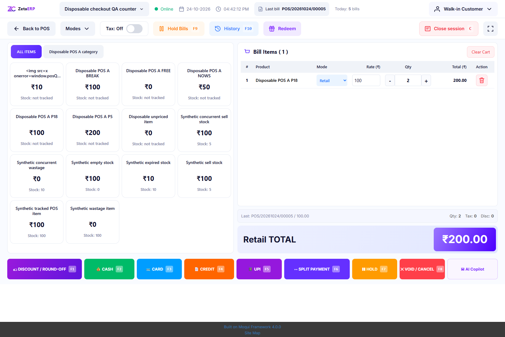
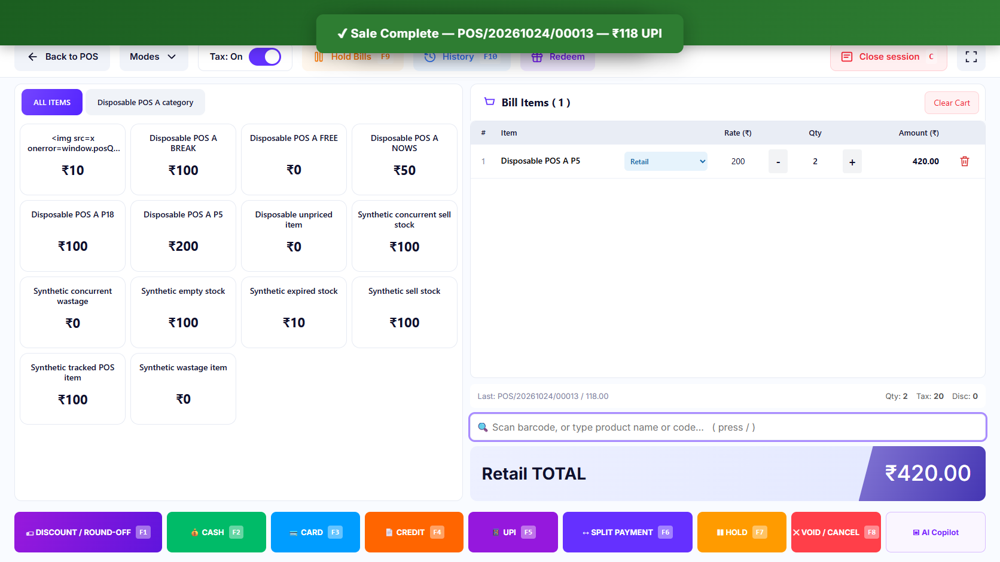

# POS header and next-bill reset — 24 October 2026

The terminal removes the technical terminal ID, cashier badge and duplicate Search button, with shorter desktop header rows. Friendly counter selection, customer selection, the main scanner and `/` shortcut remain available.

After successful payment, `resetCompletedCart()` resets the live model and cancels any scheduled optimistic render through `renderCart()`. Receipt rendering retains its independent completed-bill payload. The subsequent screen response updates catalog/session metadata without replacing a new bill's cart or transaction ID. Optimistic item-sequence claims are reset when the server returns a different transaction, so a quantity edit queued behind the next bill's first add can finish.

## Reproduction and regression

- On master, `verify-next-bill.cjs` reproduced the previous bill's product in **73 animation frames** while the next add response was delayed. The completed receipt still contained the correct original item.
- After resetting the model, an additional queued-quantity regression exposed an old claimed item sequence: the next bill's quantity request never left the queue. Scoping claims to the new transaction fixes it.
- `verify-next-bill.cjs` now covers Cash, Card, UPI and Split with tax on and off (eight combinations). It captures generated receipts with an isolated QZ stub, holds the checkout screen response and first add response, samples cart frames, queues a rapid quantity increment, checks database rows and verifies that the late screen response cannot erase the next bill. No physical print job is sent.
- `verify-checkout-reference.cjs` verifies the removed controls and exercises `/` search, tax, editing, Clear Cart, payments, hold/recall/void and layouts at 1672, 1366, 1024, 800, 390 and 320 pixels.
- The existing rapid-click catalog test now waits for its final `updateQty=12` response before checking the database. A trace showed its previous `networkidle` wait could return before the coalesced add request was even sent; the exact 12-item assertion is unchanged.
- Both helpers run from `verify-runtime.cjs` in POS acceptance.

All local browser/data checks use a disposable loopback Moqui runtime and synthetic `POS_QA_*` tenants. Production was not accessed. Source shop database files, account details and credentials are not included in this PR.

The four repository lint guards, JavaScript syntax checks and `git diff --check` pass. Root `npm run test` and `npm run build` return ENOENT because this Moqui checkout has no root `package.json`; they are not recorded as passes. Full runtime and exact-candidate CI results are reported in the PR.

## Synthetic screenshots

